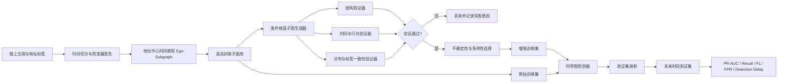

# 验证引导的时序交易子图增强实验架构

版本：V1.0
研究对象：少标签以太坊钓鱼账户检测
工作目录：`2026新/实验研究/`

## 1. 研究主张

本实验研究面向少标签以太坊钓鱼检测，构建地址中心的时间感知交易子图，并生成候选异常子图；通过结构一致性、时间约束、资金流行为和钓鱼行为 Motif 对候选样本进行分层验证，再结合检测器不确定性和样本多样性选择增强样本，检验验证后的生成样本能否在严格时间划分下提升钓鱼检测的跨时间泛化能力。

本版本不生成可直接上链执行的交易，不覆盖多种攻击类型，不把主动学习、EVM 重放、知识图谱和大规模在线检测同时纳入首版主线。

## 2. 系统边界

### 2.1 首版纳入

- 区块链：Ethereum mainnet。
- 任务：phishing / benign 地址二分类。
- 学习对象：中心地址的 1-hop 时间感知 ego-subgraph。
- 主要问题：少标签、类别不平衡、异常行为稀疏、时间演化和数据泄漏。
- 生成对象：用于训练检测器的离散/桶化交易子图，不是可执行交易序列。
- 评价目标：跨时间测试集上的检测性能、样本有效性和泛化能力。

### 2.2 首版排除

- flash loan、sandwich、rug pull、Ponzi 等其他攻击类型。
- 2-hop 或全图级生成作为主实验。
- EVM fork replay 和完整交易可执行性验证。
- 依赖 LLM 直接判断样本标签。
- 在线实时系统和跨链迁移。

## 3. 总体架构



## 4. 数据层设计

### 4.1 地址中心样本

每个样本以一个中心地址和一个截止时间构成：

```text
sample = {
  center_address,
  cutoff_time,
  label,
  nodes,
  edges,
  node_features,
  edge_features,
  temporal_metadata
}
```

### 4.2 节点定义

首版只保留：

- 中心地址；
- 与中心地址直接交易的地址；
- 必要的合约节点。

节点特征建议包括：

- 地址类型：EOA / contract；
- 入度、出度；
- 入账交易数、出账交易数；
- 入账金额、出账金额；
- 交易对手数量；
- 首次交易时间、最近交易时间；
- 活跃时间跨度；
- 是否存在短期突发行为。

### 4.3 边定义

边表示中心地址与邻居之间的交易关系，建议保留：

- 交易方向；
- ETH / Token / internal transfer 类型；
- 金额桶；
- 时间间隔桶；
- Gas 或手续费桶；
- 交易次数；
- 最近一次交互时间；
- 交易是否涉及合约调用。

首版不直接把原始金额和完整地址作为模型输入。金额使用分位数或对数桶化，地址使用匿名 ID，避免模型记忆地址和利用可操纵数值。

### 4.4 时间划分

必须按时间构造：

```text
Train: 早期时间段
Valid: 中间时间段
Test: 未来时间段
```

并额外记录：

- 地址首次出现时间；
- 标签产生时间；
- 交易发生时间；
- 样本截止时间。

生成器只能使用训练期 phishing 子图，不能访问验证集或测试集的结构、标签和统计量。

## 5. 候选子图生成器

### 5.1 生成器目标

生成用于训练的候选异常子图，目标是补充少标签 phishing 行为的结构和行为变化，不追求生成真实可执行交易。

### 5.2 首版推荐设计

采用条件式局部生成器，而不是一开始实现完整图扩散：

```text
输入：
  真实 phishing ego-subgraph
  攻击行为条件
  时间窗口条件
  目标规模条件

输出：
  候选节点集合
  候选边集合
  桶化节点/边属性
```

生成器可分三阶段实现：

#### 阶段 A：统计/规则采样基线

- 从真实 phishing 子图中采样节点数量；
- 按条件分布采样边方向和交易类型；
- 按真实分位数采样金额桶和时间间隔桶；
- 生成结构合理的候选子图。

#### 阶段 B：VAE 或条件生成模型

- 编码真实 phishing 子图；
- 在行为条件下采样潜变量；
- 解码节点、边和桶化属性；
- 使用重构损失、条件一致性损失和结构损失训练。

#### 阶段 C：扩散模型扩展

只有在阶段 A/B 已证明验证流程有效后，再替换为离散/连续混合扩散模型。

## 6. 多层验证器

验证器是本研究的核心，不是生成器的附属评分器。

### 6.1 结构一致性验证器

检查候选子图是否符合真实训练集的结构分布：

- 节点数量范围；
- 入度/出度分布；
- 入出边比例；
- 邻居数量；
- 节点类型比例；
- 交易方向比例；
- 局部 Motif 频率；
- 子图密度和连通性。

输出：`structure_score`。

### 6.2 时间一致性验证器

检查：

- 交易时间是否单调合理；
- 时间间隔是否落在真实分布范围；
- 是否出现不合理的未来时间；
- 是否产生训练集不存在的极端时间模式；
- 是否符合短期突发或长期潜伏行为条件。

输出：`temporal_score`。

### 6.3 资金流与行为验证器

首版使用图统计与规则，不做 EVM 重放：

- 入账与出账方向是否合理；
- 资金是否出现明显归集或分散；
- 中心地址是否具有异常对手方扩张；
- 是否存在短时间高频转移；
- 是否出现 phishing 相关局部 Motif；
- 是否符合训练集中的 phishing 行为范围。

输出：`behavior_score`。

### 6.4 分布和标签一致性验证器

使用独立于生成器的检测模型或统计模型：

- 真实/生成 embedding 距离；
- MMD 或 Wasserstein 距离；
- 真实 phishing 分类器的置信度；
- 多个基线模型预测的一致性；
- 生成样本与训练集的最近邻距离；
- OOD 分数。

输出：`distribution_score` 和 `label_consistency_score`。

### 6.5 综合验证规则

建议先使用硬约束，再使用软评分：

```text
hard_valid =
  valid_structure
  AND valid_time
  AND valid_behavior

quality_score =
  w1 * structure_score
  + w2 * temporal_score
  + w3 * behavior_score
  + w4 * distribution_score
  + w5 * label_consistency_score
```

只有 `hard_valid = true` 且 `quality_score >= threshold` 的候选样本才能进入主动选择池。

## 7. 样本选择模块

验证通过不代表一定要加入训练集。候选样本还需要根据检测价值进行选择。

### 7.1 不确定性

使用当前检测器计算：

- 预测熵；
- 多模型预测方差；
- MC Dropout 方差；
- 与决策边界的距离。

### 7.2 多样性

避免生成大量相似样本：

- embedding 聚类；
- k-center 选择；
- 子图结构去重；
- 行为 Motif 去重；
- 与原始训练样本的最近邻距离。

### 7.3 选择分数

```text
selection_score =
  quality_score
  * uncertainty_score
  * diversity_score
```

每轮只选择固定比例的候选样本，避免一次生成大量噪声数据。

## 8. 检测器设计

### 8.1 首版主模型

推荐使用一个可解释、易复现的时序 GNN：

- GraphSAGE 或 GAT 作为空间编码器；
- 时间间隔编码作为边特征；
- GRU 或轻量 Temporal Attention 聚合时间窗口；
- 中心地址 embedding 接分类头。

### 8.2 模型输入

```text
时间窗口 t1, t2, ..., tk
每个窗口一个中心地址 ego-subgraph
每条边包含方向、类型、金额桶和时间间隔
```

### 8.3 输出

- phishing probability；
- anomaly score；
- optional early-warning score；
- 可解释的关键邻居、关键边和关键时间窗口。

首版不建议直接使用大型 Transformer、知识图谱和多模态预训练模型作为主检测器，以免掩盖增强方法的真实贡献。

## 9. 训练流程

### 阶段 0：数据冻结

1. 完成时间划分；
2. 冻结测试集；
3. 记录标签可用时间；
4. 固化特征和数据版本；
5. 生成数据清单和哈希。

### 阶段 1：原始基线

训练原始数据上的：

- Logistic Regression；
- Random Forest；
- XGBoost；
- GraphSAGE；
- GAT；
- 时序 GNN。

### 阶段 2：候选生成

只使用训练期 phishing 子图训练生成器，产生候选样本，不触碰验证集和测试集。

### 阶段 3：验证过滤

依次执行硬约束、结构验证、时间验证、行为验证和分布验证，保留验证日志。

### 阶段 4：主动选择

使用当前检测器计算不确定性和多样性，选择有限数量的高价值候选样本。

### 阶段 5：增强训练

使用原始训练样本和选中的增强样本训练检测器，在验证集调整阈值和增强比例。

### 阶段 6：未来时间测试

只在最终测试集上报告一次结果，记录：

- 检测性能；
- 早期发现能力；
- 误报率；
- 生成样本通过率；
- 生成样本有效性；
- 跨时间性能下降。

## 10. 实验对照

必须包含：

1. 原始训练集 + GNN；
2. 类别权重 / Focal Loss；
3. SMOTE 或特征级过采样；
4. DA-HGNN 风格滑动窗口增强；
5. 无验证的生成增强；
6. 只有结构验证的增强；
7. 结构 + 时间验证；
8. 结构 + 时间 + 行为验证；
9. 完整验证引导增强；
10. 完整方法 + 主动选择；
11. 完整方法去掉主动选择；
12. 不增强的少标签强基线。

## 11. 关键消融

### 验证器消融

- 去掉结构验证；
- 去掉时间验证；
- 去掉行为验证；
- 去掉分布验证；
- 只保留分类器置信度。

### 生成器消融

- 规则采样；
- VAE；
- 扩散模型；
- 不同生成比例；
- 不同时间窗口；
- 不同条件变量。

### 标签预算消融

- 1% phishing 标签；
- 5% phishing 标签；
- 10% phishing 标签；
- 全标签参考。

### 时间泛化消融

- 相邻时间测试；
- 跨月份测试；
- 跨季度测试；
- 新地址首次出现测试。

## 12. 成功判据

研究不能只以“最终 F1 提升”作为成功标准，需要同时满足：

1. 生成样本硬约束通过率达到可接受水平；
2. 生成样本的结构和行为分布没有明显偏离真实 phishing 子图；
3. 验证后的增强优于未经验证的增强；
4. 在至少两个未来时间窗口上保持收益；
5. 在低标签预算下收益更明显；
6. 去掉主动选择后性能下降或样本效率下降；
7. 结果在不同随机种子下稳定；
8. 误报率没有因增强而明显恶化。

## 13. 建议的代码目录

```text
2026新/实验研究/
├── README.md
├── configs/
│   ├── data_split.yaml
│   ├── feature_schema.yaml
│   ├── generator.yaml
│   ├── verifier.yaml
│   └── evaluation.yaml
├── data/
│   ├── raw_manifest/
│   ├── processed/
│   ├── splits/
│   └── generated_candidates/
├── src/
│   ├── data_pipeline/
│   ├── graph_builder/
│   ├── generator/
│   ├── verifier/
│   ├── selector/
│   ├── detector/
│   └── evaluation/
├── experiments/
│   ├── baselines/
│   ├── ablations/
│   └── main_runs/
├── results/
│   ├── metrics/
│   ├── validation_logs/
│   ├── figures/
│   └── tables/
└── reports/
    ├── data_card.md
    ├── experiment_protocol.md
    └── research_claim_review.md
```

## 14. 首轮最小可行实验

为了避免一开始做得过大，首轮只实现：

1. Ethereum phishing / benign 二分类；
2. 地址中心 1-hop ego-subgraph；
3. 三个时间窗口；
4. GraphSAGE 或 GAT 检测器；
5. 规则/统计候选生成器；
6. 结构 + 时间 + 行为三类验证；
7. 1%、5%、10% phishing 标签预算；
8. 原始、无验证增强、验证增强三组对照；
9. PR-AUC、Recall、F1、FPR 和跨时间测试；
10. 固定随机种子并保存全部配置。

只有首轮结果证明“验证确实有用”，才进入 VAE 或扩散生成器阶段。
